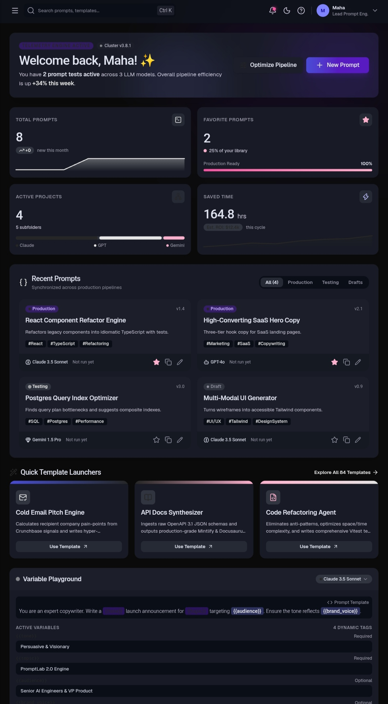
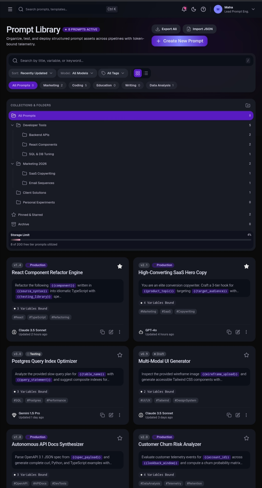
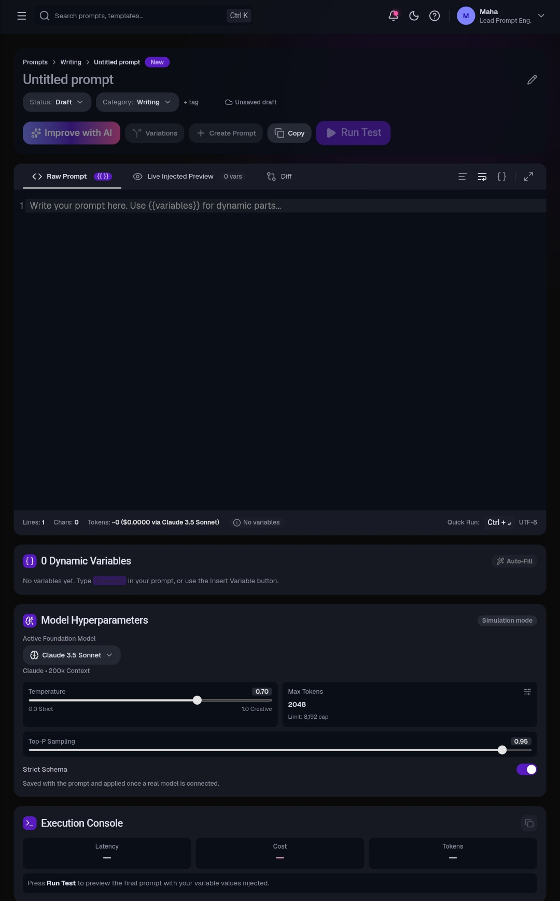
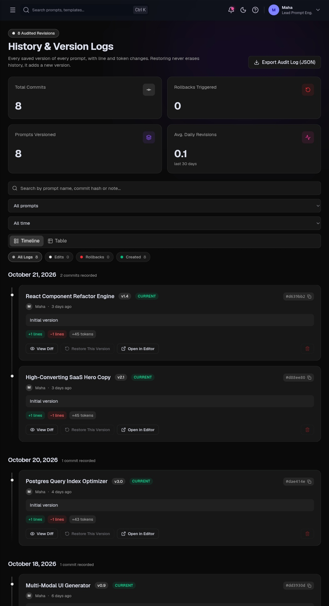
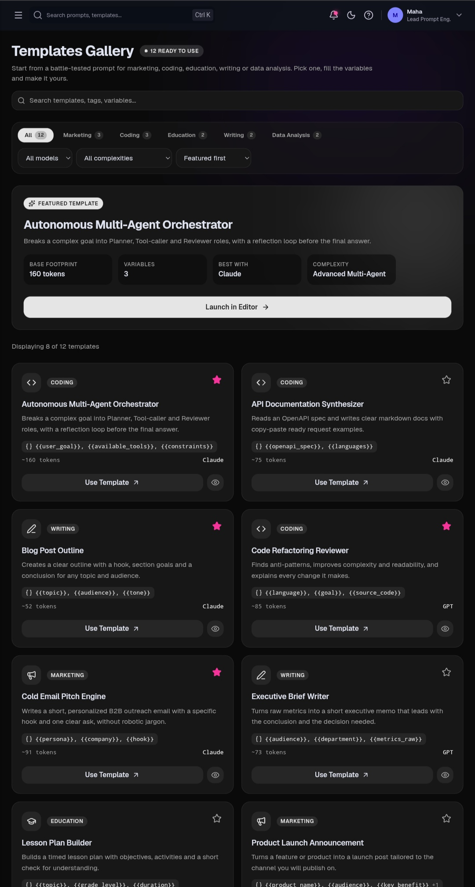
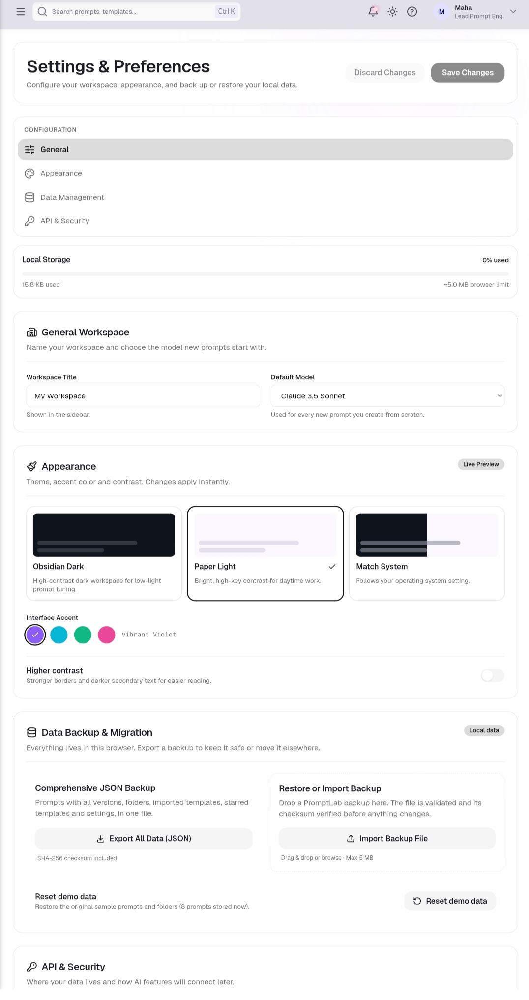

# PromptLab

**A workspace for writing, organizing, versioning and comparing prompts for AI tools.**

PromptLab is a local-first web app: you write prompts with dynamic `{{variables}}`, keep them in folders, save every meaningful change as a version, compare any two versions side by side, and restore old ones, all without an account or a backend. Your data lives in your browser and can be exported and restored as JSON at any time.


> **Live demo:** _coming soon, the link will be added after the Vercel deployment._

> **Status:** the core app (library, editor, versions, compare, templates, favorites, settings) is complete. **AI features are under development**, see the [Roadmap](#roadmap).

---

## Screenshots

| Dashboard | Prompt Library |
| :---: | :---: |
|  |  |

| Prompt Editor | Compare Versions |
| :---: | :---: |
|  |  |

| Templates | Settings (light theme) |
| :---: | :---: |
|  |  |

---

## Features

### Write and run
- **Prompt editor** built on CodeMirror, with `{{variable}}` highlighting and a side panel for variables, model and settings.
- **Dynamic variables**: values are filled in a panel and the final text is previewed before use. An **Auto-Fill** button fills the empty ones with sample values.
- **Autosave** for existing prompts. New prompts stay drafts until you click **Create Prompt**, and leaving an unsaved draft asks for confirmation.
- **Simulated run**: the console shows the resolved prompt with estimated tokens and cost. It is clearly labeled as a simulation until real AI integration lands.

### Organize
- **Prompt Library** in grid or compact list view, with instant search (title, description, content, tags), filters (category, model provider, tag), sorting and pagination.
- **Nested folders**, tags, categories, favorites and an archive.
- **Command palette** (`Ctrl/⌘ + K`) to jump to any prompt, template or page.

### Version and compare
- **Versions** with semantic labels (`v1.4` → `v1.5` minor, `v2.0` major) and a note describing each change.
- **History**: a timeline or table of every version across all prompts, with filters, stats and an inline diff.
- **Compare**: pick any two versions of a prompt and see the differences in split or unified view, with a minimap, word-level highlighting and a shareable URL. Export the result as a unified diff.
- **Restore** creates a *new* version with the old content, so history is never rewritten. Restoring and deleting ask for confirmation.

### Templates and favorites
- **12 built-in templates** across marketing, coding, education, writing and data analysis, with preview and a one-click **Use template** that creates a prompt.
- **Import your own templates** from JSON (validated with Zod).
- **Favorites** collects starred prompts and templates, with filters, folder and variable shortcuts, undo, and **Export Starred (JSON)**.

### Your data
- **Local-first**: everything is stored in `localStorage`, no account and no backend.
- **Full backup and restore** from Settings: one JSON file with prompts, versions, folders, imported templates, favorites and settings. It includes a **SHA-256 checksum**, is validated with Zod on import, and can be **merged** into or **replace** your current data.
- **Storage meter** showing how much browser storage PromptLab uses.

### Experience
- **Dark, light and system themes**, four accent colors and a higher-contrast mode.
- **Responsive** layout for phones, tablets and desktops.
- **Accessible by design**: semantic HTML, native `<dialog>` modals with focus handling, ARIA roles for tabs, switches and comboboxes, visible focus states and full keyboard navigation. Animations respect `prefers-reduced-motion`.
- Loading, error and empty states throughout, plus a custom 404 page and route error screen.

### Keyboard shortcuts

| Shortcut | Where | Action |
| --- | --- | --- |
| `Ctrl/⌘ + K` | Anywhere | Open search |
| `Ctrl/⌘ + Enter` | Editor | Run the prompt |
| `H` | Favorites (card focused) | Remove from favorites |
| `Esc` | Dialogs | Close |

---

## Tech stack

| Area | Tools |
| --- | --- |
| Framework | React 19, TypeScript (strict), Vite |
| Routing | React Router 7 (data router, lazy-loaded pages) |
| Styling | Tailwind CSS v4, shadcn/ui-style components, Lucide icons |
| State | Zustand with `persist` (localStorage) |
| Forms and validation | React Hook Form + Zod |
| Editor | CodeMirror (`@uiw/react-codemirror`) |
| Motion | GSAP + ScrollTrigger, Lenis smooth scrolling |
| Dates | date-fns |
| Testing | Vitest, React Testing Library, jsdom |
| Reserved for the AI phase | TanStack Query, Axios |

The visual design was created in **Google Stitch** (the "Obsidian Kinetic" design system) and implemented with design tokens that support both dark and light themes.

---

## Getting started

**Requirements:** Node.js 20.19+ (or 22.12+) and npm.

```bash
# 1. Clone
git clone https://github.com/mahaabusyam/promptlab.git
cd promptlab

# 2. Install dependencies
npm install

# 3. Start the dev server
npm run dev
```

Then open the URL printed in the terminal (usually `http://localhost:5173`). The app starts with a few demo prompts; use **Settings → Reset demo data** to restore them at any time.

### Scripts

| Command | What it does |
| --- | --- |
| `npm run dev` | Start the development server |
| `npm run build` | Type-check (`tsc -b`) and build for production |
| `npm run preview` | Preview the production build locally |
| `npm run lint` | Run ESLint |
| `npm test` | Run the test suite in watch mode (`npx vitest run` for a single run) |

Before deploying, run `npm run lint && npm run build && npx vitest run`.

---

## Project structure

The code is organized **by feature**. Business logic (filters, diffing, validation, import/export) lives in small pure functions that are unit-tested, separate from the UI.

```text
src/
├── app/            # router, providers, route error handling
├── components/
│   ├── ui/         # base UI components
│   ├── layout/     # sidebar, header, app layout
│   └── common/     # shared pieces (dialogs, pagination, status screens...)
├── features/
│   ├── dashboard/  ├── library/    ├── editor/     ├── prompts/
│   ├── versions/   ├── history/    ├── compare/    ├── templates/
│   ├── favorites/  ├── settings/   └── search/
├── pages/          # one file per route
├── stores/         # Zustand stores (prompts, templates, settings, theme...)
├── hooks/          # shared hooks
├── utils/          # pure helpers (variables, tokens, diff helpers, download...)
├── data/           # seed prompts and built-in templates
└── test/           # test helpers
```

### Routes

| Path | Page |
| --- | --- |
| `/` | Dashboard |
| `/library` | Prompt Library |
| `/editor`, `/editor/:promptId` | Prompt Editor (new / existing) |
| `/templates` | Templates |
| `/history` | History |
| `/compare` | Compare Versions |
| `/favorites` | Favorites |
| `/settings` | Settings |
| `*` | Not Found |

---

## Data and privacy

All data stays in your browser. PromptLab uses these `localStorage` keys:

| Key | Contents |
| --- | --- |
| `promptlab-prompts` | Prompts, versions and folders |
| `promptlab-templates` | Imported templates and starred templates |
| `promptlab-settings` | Workspace name, default model, accent, contrast |
| `promptlab-theme` | Theme choice |
| `promptlab-library`, `promptlab-favorites-view` | View preferences |

Clearing your browser data removes your prompts, so **export a backup** from Settings regularly. Every imported file is validated with Zod before it can touch the app's state.

---

## Testing

The suite covers the logic the app depends on most:

- prompt **CRUD**, version saving, restoring and deleting (`promptStore`)
- **variable** extraction, substitution and truncation
- **version labels** and the **diff** algorithm
- **search** and **filters**, pagination
- **import / export** parsing, validation and backup checksums
- templates and favorites logic
- a React Testing Library component test (variables panel)

```bash
npx vitest run
```

Tests for AI request failures (timeouts, rate limits, errors) will be added together with the AI integration.

---

## Roadmap

The first version intentionally works **without any AI service**, so the library, editor and versioning are fully usable offline. AI features are **in development** and will be optional:

- [ ] **Improve Prompt**: suggest improvements to the current text
- [ ] **Generate Variations**: create alternative versions of a prompt
- [ ] **Real Run Test**: send a prompt to a model and show the result, replacing the current simulation
- [ ] **Task type, tone and answer length** controls for these actions
- [ ] Clear **loading, error and rate-limit** states for every AI request, with tests for API failures
- [ ] A small **secure proxy service** between the app and the AI provider (TanStack Query + Axios on the client)
- [ ] Production deployment on **Vercel**

> **Security note:** the AI provider's secret key will never be placed in the React app or in `VITE_*` variables, because those are bundled into the browser. Requests will go through a server-side proxy that keeps the key private.

---

## Author

Built by **[mahaabusyam](https://github.com/mahaabusyam)**.

